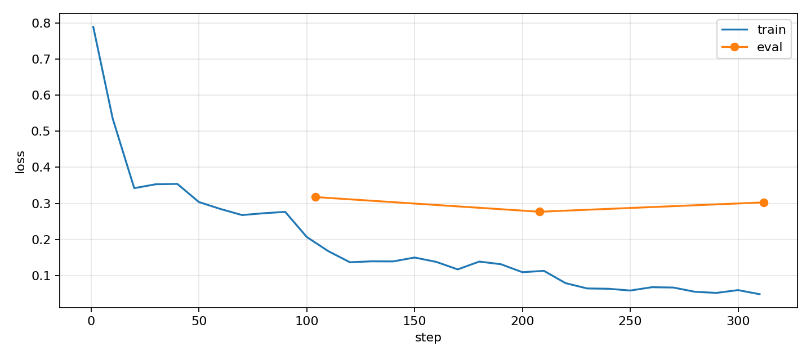

# HW3: SFT для вызова функций умного дома

Дообучение `Qwen/Qwen2.5-0.5B-Instruct` на диалогах с пятью инструментами
учебного симулятора: свет, температура, состояние комнаты, покупки и таймеры.

## Решение

- [Выполненный notebook](sft_function_calling_hw.ipynb): реализация генерации,
  assistant-only маски, обучение, сравнение моделей и пять сценариев агента.
- [Скрипт обучения](train_distributed.py): полный fine-tuning через DDP на двух GPU.
- [Симулятор](smart_home.py) и [интерфейс чата](chat_ui.py).
- `data/`: 831 обучающий диалог, 91 валидационный диалог и 60 тестовых случаев.

## Запуск

Из папки `hw3` на сервере с двумя NVIDIA GPU:

```bash
bash setup_a100.sh
CUDA_VISIBLE_DEVICES=0,1 .venv-hw3/bin/python execute_notebook.py
```

Установочный скрипт создаёт отдельное окружение `.venv-hw3` и проверяет CUDA
на обеих картах. Notebook сам запускает два процесса обучения; дополнительный
внешний `torchrun` не требуется. Полное выполнение повторяет обучение и оценку.

Веса сохраняются в `outputs/full_sft/` и исключены из Git. Для просмотра
готовых результатов повторно запускать обучение не нужно.

## Результаты

Все 494 032 768 параметров обучались три эпохи: 312 шагов, общий batch 8,
learning rate `5e-5`, BF16, seed 42. Обучение на двух A100 заняло 61,3 секунды.

| Модель | Язык | Tool set accuracy | Exact match |
|---|---|---:|---:|
| Base | EN | 75,0% | 55,0% |
| SFT | EN | 97,5% | 92,5% |
| Base | RU | 75,0% | 20,0% |
| SFT | RU | 95,0% | 95,0% |

На всех 60 случаях exact match вырос с 26/60 до 56/60.
Пять сценариев агента прошли, включая два вызова в одной реплике и
последовательное изменение температуры 21 → 23 → 25.



Третья эпоха дала более высокий validation loss, чем вторая
(0,30268 против 0,27676). Четыре тестовых контекста совпадают с префиксами
train/validation. На остальных 56 случаях exact match: 41,07% у Base
и 92,86% у SFT. Эти результаты относятся к одному запуску и небольшому тесту.

## Файлы результатов

- [Метрики](outputs/eval_results.csv).
- [Все тестовые ответы](outputs/eval_predictions.csv).
- [Десять ответов до и после SFT](outputs/comparison.csv).
- [Истории агента и состояния симулятора](outputs/agent_results.json).
- [История обучения](outputs/training_history.csv).
- [Параметры и версии запуска](outputs/run_manifest.json).
