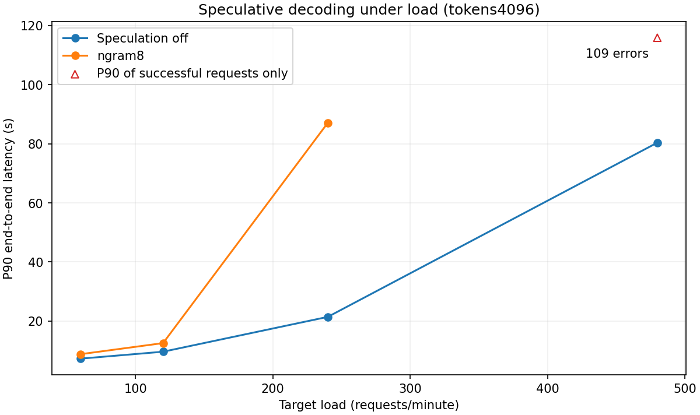
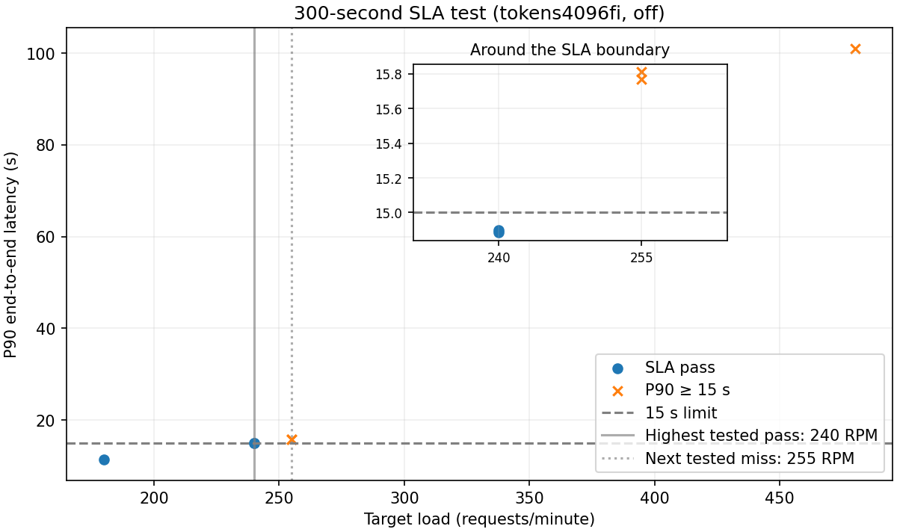

# HW6. Инференс Qwen3-8B на одной A100

## 1. Ускорение при 120 RPM

Лучший из проверенных вариантов — бюджет 4096 токенов, `FLASHINFER` и `interactivity` без спекуляции. Mean E2E уменьшился с **6,884 до 6,216 с**, ускорение **1,1075×**, снижение средней задержки на **9,71%**. P90 снизился с **9,694 до 8,373 с**.

| Конфигурация | Валидных прогонов | Mean E2E, с | Медиана P90 прогонов, с | Ускорение |
|---|---:|---:|---:|---:|
| vLLM по умолчанию | 2 | 6,884 | 9,694 | 1,0000× |
| **Бюджет 4096 + FlashInfer + interactivity** | **2** | **6,216** | **8,373** | **1,1075×** |
| Бюджет 4096 токенов | 2 | 6,835 | 9,635 | 1,0071× |
| Лимит 32 последовательности | 1 | 6,869 | 9,702 | 1,0022× |
| Бюджет 1024 токена | 1 | 6,981 | 9,845 | 0,9861× |
| Бюджет 4096 + n-gram, до 8 токенов | 1 | 8,114 | 12,551 | 0,8484× |

Для конфигураций с повторами Mean E2E — среднее двух полных прогонов с одинаковым числом запросов. Бейзлайн дал 6,879 и 6,889 с, а изменение только бюджета до 4096 — 6,834 и 6,837 с. Выигрыш одного этого изменения составил около 0,7%.

При 4096 токенах планировщик может обработать больше входных токенов за шаг, чем при штатном для этого A100 бюджете 2048. В первом замере средняя TTFT сместилась с 119,6 до 115,3 мс, а средняя ITL — с 16,01 до 15,92 мс. Разница согласуется с изменением обслуживания длинных входов и планирования декодирования. Вклад каждого механизма этим экспериментом отдельно не идентифицируется.

Пара `4096 + n-gram 4` дала 8,198 с Mean E2E и 12,335 с P90 по 639 успешным запросам. Один запрос завершился `ServerDisconnectedError`, поэтому прогон исключён из ранжирования и сохранён в полной таблице. Вариант с восемью токенами прошёл 640 из 640 запросов и выбран для парной проверки по RPM.

Средняя длина ответа осталась близкой между конфигурациями. Например, в первом прогоне с бюджетом 4096 она составила 419,46 токена, с добавлением `n-gram 8` — 419,25. При этом средний ITL вырос с 15,92 до 19,11 мс, а TTFT снизилась со 115,3 до 109,4 мс. Замедление пришло с этапа декодирования. Вариант с восемью токенами принял 57 649 из 378 901 предложенных токенов, или 15,2%. Логи также показывают переход с V2 на V1 Model Runner и отключение асинхронного планирования в режиме CPU n-gram. Измерение отражает совместный эффект черновых токенов и связанных с методом изменений среды исполнения.

### Дополнительный отбор

В конфигурации с бюджетом 4096 средняя TTFT составляла 115 мс из 6,834 с E2E. Для дальнейшего ускорения проверены два варианта, которые меняют работу декодирования при той же ревизии Qwen3-8B.

- `FLASHINFER` и `--performance-mode interactivity` на бюджете 4096. Первый флаг меняет attention-бэкенд, второй добавляет более плотную сетку размеров CUDA Graph для малых батчей. Скрининг оценивает сочетание флагов.
- `ngram_gpu` с двумя черновыми токенами переносит поиск совпадений на GPU и сохраняет асинхронное планирование в этой версии vLLM.

Оба скрининга запрашивали первые 160 элементов исходного файла при 120 RPM. Для отбора сравнивались позиции 21–140 с теми же позициями двух полных контрольных прогонов. Длины входов совпали по каждой позиции. FlashInfer с `interactivity` снизил среднее с 6,572 до 6,148 с, то есть на 6,4%, при средней длине выхода 429 против 423 токенов. У `ngram_gpu` один запрос завершился ошибкой, а Mean E2E по 159 успешным запросам составил 8,382 с. Результаты скрининга сохранены отдельно от полного сравнения.

В обоих полных прогонах FlashInfer с `interactivity` прошли все 640 запросов. Mean E2E составил 6,216 и 6,215 с, P90 — 8,373 и 8,374 с. В первом прогоне средняя длина выхода составила 420,68 токена, средний ITL снизился до 14,45 мс, а средняя TTFT — до 108,9 мс. Сочетание флагов улучшило прежде всего декодирование, где лежит большая часть E2E на этой трассе.

[Все прогоны](evidence/runs.csv) · [Таблица 120 RPM](evidence/tuning_120rpm.csv) · [Документация vLLM о спекулятивном декодировании](https://docs.vllm.ai/en/v0.22.0/features/speculative_decoding/)

## 2. Спекулятивное декодирование под нагрузкой

В обеих ветках задан бюджет 4096 токенов и автоматический выбор attention-бэкенда. Спекулятивная ветка использует CPU `n-gram` с черновиком до восьми токенов и окном поиска 2–5. При 120 RPM использованы замеры из первой части. Для ветки без спекуляции в этой точке показана медиана P90 двух прогонов.

| Нагрузка, RPM | P90 без спекуляции, с | P90 с n-gram, с | Ошибок с n-gram |
|---:|---:|---:|---:|
| 60 | 7,293 | 8,809 | 0 |
| 120 | 9,635 | 12,551 | 0 |
| 240 | 21,426 | 87,083 | 0 |
| 480 | 80,357 | 115,862 по успешным запросам | 109 из 640 |

Конфигурация с `n-gram 8` проиграла уже на минимальной проверенной нагрузке **60 RPM**. В диапазоне валидных пар 60–240 RPM перехода от выигрыша к проигрышу не наблюдалось. При 480 RPM в спекулятивной ветке 109 запросов достигли таймаута 120 с. Показанные 115,862 с — P90 по 531 успешному запросу. Пустой маркер на графике выделяет это условное значение.

При 240 RPM средняя задержка между токенами выросла с 33,6 мс без спекуляции до 119,4 мс с ней, а TTFT — со 177 до 559 мс. На этой трассе режим с CPU `n-gram` терял пропускную способность по мере роста нагрузки. Сравнение отражает работу двух доступных режимов сервера, включая переход на V1 и отключение асинхронного планирования в спекулятивной ветке.

[Исходные замеры обеих веток](evidence/runs.csv) · [Ограничения Model Runner V2](https://github.com/vllm-project/vllm/blob/v0.22.0/vllm/config/vllm.py#L1834-L1867)

## 3. Максимальная нагрузка при SLA

На конфигурации **4096 + FlashInfer + interactivity** максимальная подтверждённая нагрузка составила **240 RPM, или 4 запроса/с**. Оба 300-секундных прогона дали P90 ниже 15 с. На ближайшем проверенном шаге, **255 RPM**, оба прогона дали P90 выше порога.

| Нагрузка, RPM | P90 по отдельным прогонам, с | Ошибок | P90 < 15 с |
|---:|---:|---:|:---|
| 180 | 11,315 | 0 | Да |
| **240** | **14,885 и 14,896** | **0** | **Да** |
| **255** | **15,810 и 15,771** | **0** | **Нет** |
| 480 | 101,049 | 0 | Нет |

Сначала проверили 180 и 240 RPM, затем измерили перегрузку на 480 RPM. После этого уточнили границу шагом 15 RPM и повторили обе пограничные точки на свежих запусках сервера. Фактическая частота при 240 и 255 RPM отличалась от номинала меньше чем на 0,002 RPM. Запас при 240 RPM составлял около 0,10 с в обоих прогонах. Порог относится к этому серверу, трассе и правилу циклического воспроизведения после 640 запросов.

[Граница SLA и показатели всех повторов](evidence/sla-boundary.json) · [Архив команд и метрик по запросам](evidence/benchmark-records.tar.gz)

## Окружение и методика

Все замеры выполнены на одной NVIDIA A100-SXM4-80GB, GPU 1 учебной VM, с драйвером 570.86.15. Образ собран из Dockerfile задания на `vllm/vllm-openai:v0.22.0-cu129`. Клиент — AIPerf 0.13.0 с Transformers 5.22.1. Модель и токенизатор — `Qwen/Qwen3-8B`, ревизия `b968826d9c46dd6066d109eabc6255188de91218`.

Клиент последовательно воспроизводил `requests.jsonl` с исходными параметрами `temperature=0`, `seed=42`, `max_tokens=512` и `enable_thinking=false`. Подача шла с постоянной заданной частотой, без клиентского ограничения на число запросов в полёте. Каждый прогон начинался с очистки prefix cache и прогрева на 40 запросах при concurrency 8. После измерения кеш сбрасывался повторно. Среднее и P90 рассчитаны по метрике `request_latency` AIPerf, от отправки запроса до последнего содержательного чанка стрима. Прогрев исключён.

В частях 1 и 2 один измеряемый прогон включает все 640 запросов. В части 3 длительность подачи составляет 300 секунд. При RPM выше 128 последовательный семплер циклически воспроизводит исходный набор. Проверка валидности использует фактические метки отправки и допускает отклонение частоты до 2% от номинала. Для прохождения SLA дополнительно требуются полное окно подачи, отсутствие ошибок и P90 строго ниже 15 секунд.

[Определения метрик AIPerf](https://github.com/ai-dynamo/aiperf/blob/v0.13.0/docs/metrics-reference.md) · [Последовательный семплер AIPerf](https://github.com/ai-dynamo/aiperf/blob/v0.13.0/src/aiperf/dataset/dataset_samplers.py)

Команды для повторных запусков и пересчёта таблиц и графиков приведены в [README](README.md).
